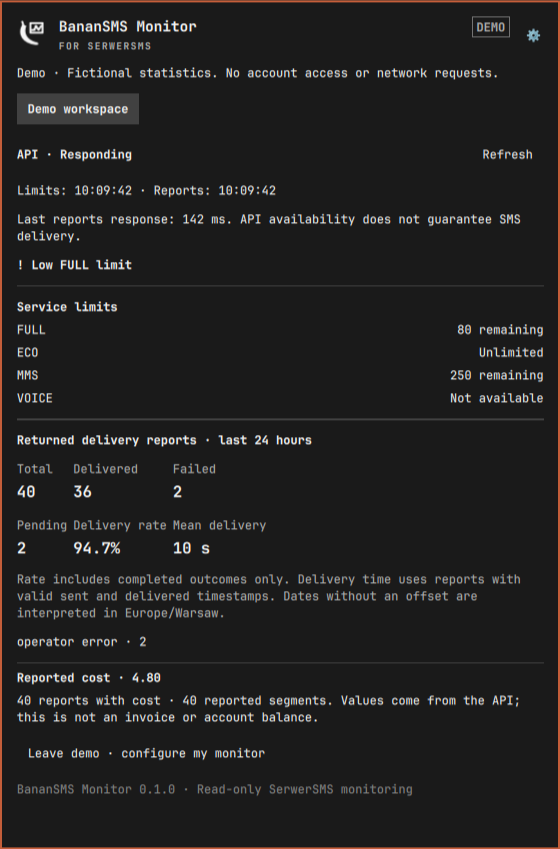

# BananSMS Monitor for SerwerSMS

A read-only Omarchy bar plugin for SerwerSMS service limits, delivery reports and
local alerts. The interface is in English. A monochrome banana/monitor icon matches
the compact panel header.

## Features

- Up to five accounts, selected at the top of the overview.
- Remaining service limits, including unlimited and unavailable services.
- Aggregated reports for the last 24 hours: delivered, failed, pending, delivery
  rate, reported segments, reported cost and mean delivery time.
- API response time, separate limits/reports errors and last successful check times.
- Configurable low-limit, failed-delivery and long-pending thresholds.
- Generic desktop alerts on newly observed alert conditions, without account names,
  phone numbers or message content. Repeated identical conditions do not notify again.
- Visibility controls for limits, delivery statistics and costs.
- Mandatory SQLCipher storage, master-password locking and isolated demo mode.

## Install and remove

Requires Omarchy with its Quickshell plugin system, Python 3 and the Arch
`sqlcipher` package. No third-party Python modules or background service installation
are required. Install SQLCipher yourself if it is missing:

```sh
omarchy pkg add sqlcipher
```

Install the plugin from its public repository:

```sh
omarchy plugin add https://github.com/blazejkapala/omarchy-banansms-monitor.git --enable
```

For a manual installation, place this directory at `~/.config/omarchy/plugins/banan.banansms-monitor`, then run:

```sh
omarchy plugin validate ~/.config/omarchy/plugins/banan.banansms-monitor
omarchy-shell shell rescanPlugins
omarchy plugin enable banan.banansms-monitor --section right
```

Use `omarchy restart shell` if source changes are not reflected in the UI.
Remove with `omarchy plugin remove banan.banansms-monitor` and confirm in the terminal.
Removal preserves `~/.local/state/banansms-monitor` for recovery/reinstallation.
Delete that directory separately only if you no longer need the vault or its backup.
These paths respect `XDG_STATE_HOME`. Removing a local account never changes the
provider account, service configuration or messages.

## Setup

1. Open the banana/monitor icon and create a master password (8–128 characters).
2. Open the gear and choose **Add account**.
3. Enter a local account label and a SerwerSMS API token. Generate the token in the
   provider panel under **Interface settings → HTTPS API → API tokens**.
4. Choose **Check and save account**. A limits query validates access before saving.
   Reports access is checked separately during monitoring.

Tokens are entered into the plugin, not a command line or a chat. **Update token**
replaces an existing local account's credential after validation. There is no need
to provide a Twilio credential, SSH connection or phone number.

## Monitoring behavior

Only these two exact HTTPS API endpoints are allowed in the transport:

- `https://api2.serwersms.pl/account/limits.json`
- `https://api2.serwersms.pl/messages/reports.json`

Both use POST as required by SerwerSMS, but only retrieve information. The plugin
has no sending, purchasing, contact-editing, mark-as-read or provider-deletion
operation. Redirects are rejected. A token itself may have wider permissions in
the provider account; the plugin's endpoint restriction is not a provider-enforced
token scope.

Limits refresh hourly. Reports default to every 5 minutes, configurable from 60 to
3600 seconds; the UI checks whether work is due once a minute. Manual refresh
respects a 30-second minimum between attempts per endpoint. The settings page
controls thresholds and the inactivity timeout (30–86400 seconds, default 15 minutes).
Thresholds derived during aggregation take effect on the next successful report fetch.

Monitoring runs only while the vault is unlocked and the Omarchy shell is running.
Closing the panel does not immediately stop checks, but the inactivity timer keeps
running. Polls do not count as user activity. Locked state is shown explicitly;
unlock to resume. API connectivity reflects the most recent request, not a
continuous availability guarantee. A response from the API does not establish that
SMS delivery is working.

### Interpretation and limits

- The query window is a rolling 24 hours in Europe/Warsaw. Provider timestamps
  without a UTC offset are interpreted in Europe/Warsaw. This is an explicit local
  interpretation of the API's offset-free date examples.
- Figures summarize the reports returned by the endpoint, not a guaranteed complete
  billing archive. Duplicate report IDs are counted once. Responses over 4 MB are
  rejected instead of publishing truncated totals.
- Delivery rate uses `delivered / (delivered + undelivered + unsent)`.
  Pending, scheduled and unknown states are excluded from that denominator.
- Failure alerts require at least five completed outcomes. Long-pending alerts
  cover `sent`, `pending` and `in_progress`; scheduled `saved` reports are excluded.
- Mean delivery time uses only delivered reports with valid sent/delivered times.
- Cost sums nonnegative finite `cost` values returned by the API. Coverage is shown.
  No currency or tax interpretation is assumed. This is not an invoice or balance;
  costs may be missing, including for provider test packages.
- Failures preserve the last successful aggregate with its original timestamp and
  an error indicator. The old value is not presented as a new successful check.
- API error text is sanitized. Errors may contain private data, so raw provider
  error messages are not displayed or logged.

## Encrypted storage and privacy

Accounts/tokens, settings, aggregate caches and remembered alert conditions are
stored inside `~/.local/state/banansms-monitor/vault.db` using SQLCipher. The file
has mode 600 in a directory with mode 700. Only password-attempt counters, containing
no credentials, are stored separately. No plaintext storage mode is provided.

The helper holds its database key while unlocked. Passwords are passed over stdin,
never command-line arguments, and are not saved. SQLCipher handles key derivation,
page encryption and authentication. Memory wiping is enabled and temporary SQL
storage stays in memory; database journal pages are encrypted. Core dumps and
ordinary same-user ptrace access to the helper are disabled.

Locking clears the UI and terminates the helper. A helper watchdog also exits at
expiry even if an API request is blocked. The database starts locked after restart.
Changing the master password requires the current one and uses SQLCipher rekey.
There is no password recovery. Back up the closed vault and keep its password safely.

The reports API can return recipient numbers and message text. These are received
transiently in helper memory but are discarded during aggregation: neither the UI
nor the encrypted cache receives those fields. The cache contains aggregate counts,
known failure categories, timestamps and costs. The plugin does not import any
existing Bananilio data or credentials.

Encryption protects a closed database without its password; it is not isolation
from malicious software capable of altering plugin code or capturing an unlocked
desktop. Python/Qt memory copies may remain until reclaimed. System snapshots,
swap and external backups require their own protection.

## Demo

Choose **Explore demo** even before creating a vault. Demo requests never read
private storage and never access the network. Leave demo to create/unlock your
real monitor. You can also set it from a terminal:

```sh
omarchy bar set banan.banansms-monitor demo true --json
omarchy bar set banan.banansms-monitor demo false --json
```

## Preview

The screenshot shows synthetic demo statistics only. No real account credentials,
account statistics, recipient numbers or messages are included.



## Development

```sh
python3 -m unittest -v test_client
omarchy plugin validate .
```

Tests use synthetic credentials, temporary databases and mocked provider responses.
No real SMS is sent. SQLCipher is required for database tests.

## API references

- [Authentication](https://dev.serwersms.pl/https-api-v2/autoryzacja)
- [Account limits](https://dev.serwersms.pl/https-api-v2/sprawdzanie-stanu-konta)
- [Delivery reports](https://dev.serwersms.pl/https-api-v2/sprawdzanie-raportow-doreczen-wiadomosci)

MIT licensed. SQLCipher integration and the native Canvas banana artwork are
adapted from the author's Bananilio plugin. This is an independent community
plugin, not an official SerwerSMS application.
